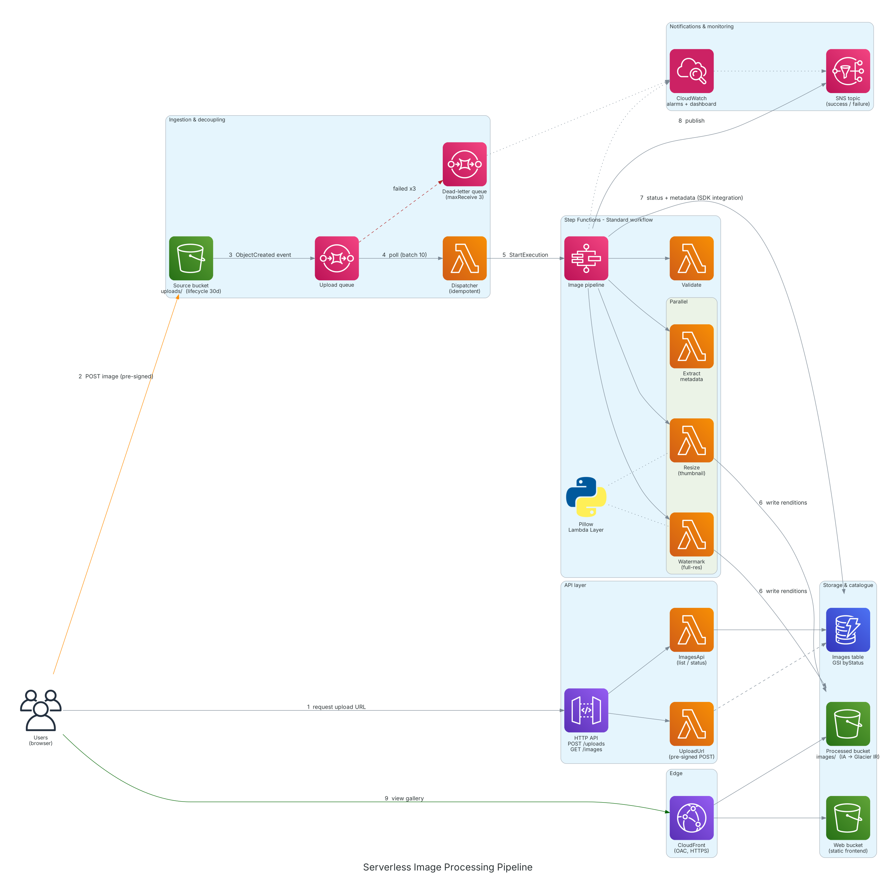
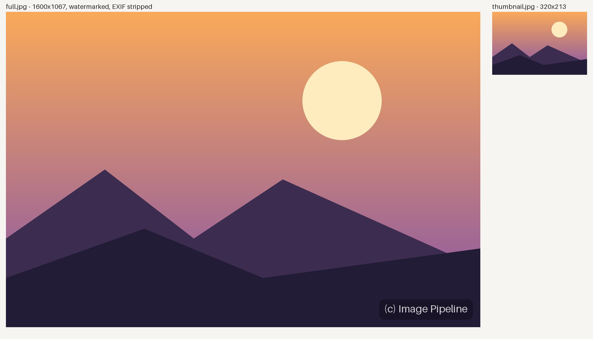
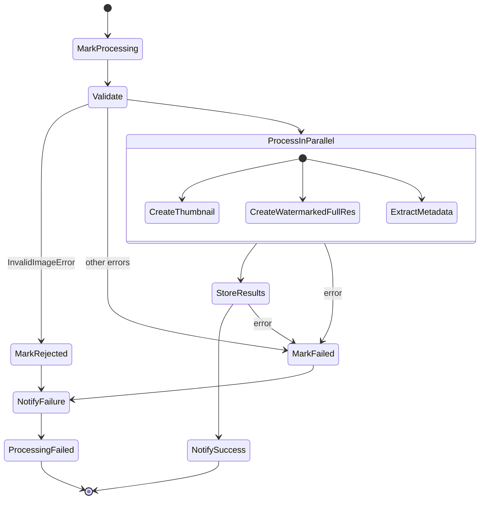

# Serverless Image Processing Pipeline on AWS

> **AWS Solutions Architect – Associate · Graduation Project (Project 2)**
> Author: **Rahma Mahmoud Hassan** · AI & Data Science Engineer · Cairo, Egypt

An event-driven, fully serverless pipeline that accepts image uploads, validates them, and produces a **thumbnail**, a **watermarked full-resolution rendition** and a **metadata record** for every image, then serves the results globally through **CloudFront**.
Everything is defined as code with **AWS SAM / CloudFormation** and deploys with one command.


---

## Table of contents

1. [Solution architecture](#1-solution-architecture)
2. [How a request flows through the system](#2-how-a-request-flows-through-the-system)
3. [AWS services and why each one is used](#3-aws-services-and-why-each-one-is-used)
4. [Step Functions workflow](#4-step-functions-workflow)
5. [Key design decisions](#5-key-design-decisions)
6. [Security](#6-security)
7. [Reliability, scalability and monitoring](#7-reliability-scalability-and-monitoring)
8. [Cost](#8-cost)
9. [Repository structure](#9-repository-structure)
10. [Deployment](#10-deployment)
11. [Testing](#11-testing)
12. [Demo](#12-demo)
13. [Clean-up](#13-clean-up)
14. [Learning outcomes covered](#14-learning-outcomes-covered)
15. [Possible improvements](#15-possible-improvements)

---

## 1. Solution architecture



*Diagram generated as code with the [`diagrams`](https://diagrams.mingrammer.com/) library – source: [`docs/diagram.py`](docs/diagram.py).*

**Example output** (real output of the `watermark` and `resize` functions):



---

## 2. How a request flows through the system

| # | Step | Service(s) |
|---|------|-----------|
| 1 | The web app asks the API for an upload URL (`POST /uploads`). A Lambda records the image as `PENDING_UPLOAD` in DynamoDB and returns a **pre-signed S3 POST** valid for 5 minutes. | API Gateway, Lambda, DynamoDB |
| 2 | The browser uploads the file **directly to S3**. The POST policy enforces the key, the content type and a 10 MB size limit – the image never passes through API Gateway or Lambda. | S3 (source) |
| 3 | S3 emits an `ObjectCreated` **event notification** for the `uploads/` prefix into an SQS queue. | S3 → SQS |
| 4 | The **Dispatcher** Lambda polls the queue in batches of up to 10 and starts one Step Functions execution per image. Failed messages are retried and, after 3 attempts, moved to the **dead-letter queue**. | SQS, Lambda, SQS DLQ |
| 5 | The **Standard workflow** marks the image `PROCESSING`, **validates** it, then runs **thumbnail**, **watermark** and **metadata extraction** in parallel. | Step Functions, Lambda + Pillow layer |
| 6 | Renditions are written to the **processed bucket** under `images/{imageId}/`. | S3 (processed) |
| 7 | Step Functions writes status, dimensions, keys and metadata to DynamoDB through a **direct SDK integration** (no Lambda needed). | DynamoDB |
| 8 | A success or failure message is published to **SNS** (e-mail subscription optional). | SNS |
| 9 | The gallery calls `GET /images` (DynamoDB GSI query) and loads the images from **CloudFront**, which reads from S3 through **Origin Access Control**. | API Gateway, CloudFront |

---

## 3. AWS services and why each one is used

| Service | Role in the solution | Configuration highlights |
|---|---|---|
| **Amazon S3 – source** | Landing zone for raw uploads | Private, SSE-S3, CORS for browser POST, event notification to SQS on `uploads/`, lifecycle: expire originals after 30 days |
| **Amazon S3 – processed** | Stores thumbnails and full-res renditions | Private (CloudFront-only via OAC), lifecycle: Standard → Standard-IA (30 d) → Glacier Instant Retrieval (90 d) |
| **Amazon S3 – web** | Hosts the static frontend | Private, served only through CloudFront |
| **Amazon SQS + DLQ** | Decouples upload events from processing | SSE, visibility timeout = 6 × consumer timeout, `maxReceiveCount = 3`, 14-day DLQ retention |
| **AWS Lambda** | Dispatcher, Validate, Resize, Watermark, Metadata, UploadUrl, ImagesApi | Python 3.12, X-Ray tracing, least-privilege SAM policy templates, memory sized per task |
| **Lambda Layer** | Packages **Pillow** once and shares it across 4 functions | Built by `sam build` from `layers/pillow/requirements.txt` |
| **AWS Step Functions** | Orchestrates validate → parallel processing → store → notify | Standard workflow, retries with exponential back-off + jitter, `Catch` → failure path, DynamoDB & SNS service integrations |
| **Amazon API Gateway (HTTP API)** | Pre-signed URL endpoint and read API | CORS, throttling (10 rps / burst 20) |
| **Amazon DynamoDB** | Image metadata and job status | On-demand capacity, GSI `byStatus` (`status` + `createdAt`) for "newest completed images", PITR, encryption |
| **Amazon CloudFront** | Global delivery of the web app and processed images | Two S3 origins with **OAC**, HTTPS only, managed caching & security-header policies, HTTP/3 |
| **Amazon SNS** | Job completion / failure notifications and alarm actions | Optional e-mail subscription |
| **Amazon CloudWatch** | Logs, alarms and dashboard | Alarms on DLQ depth and failed executions; dashboard for executions, queue depth, duration p90 and errors |
| **AWS X-Ray** | Distributed tracing | Enabled on all functions and the state machine |
| **AWS IAM** | Access control | One role per function, scoped to exact buckets / table / state machine |

---

## 4. Step Functions workflow



Definition: [`statemachine/pipeline.asl.json`](statemachine/pipeline.asl.json)

- **`MarkProcessing` / `StoreResults` / `MarkFailed`** call DynamoDB `UpdateItem` directly – fewer Lambdas, less code, less cost.
- **`Validate`** distinguishes *permanent* errors (`InvalidImageError` → `REJECTED`, never retried) from *transient* ones (Lambda throttling / service errors → retried with back-off).
- **`ProcessInParallel`** runs the three independent tasks concurrently, so total latency ≈ the slowest branch instead of the sum.

---

## 5. Key design decisions

**Why SQS between S3 and processing (instead of S3 → Lambda directly)?**
- **Buffering:** a burst of uploads queues up instead of overwhelming downstream services; the consumer controls the pace (batch size, batching window).
- **Retries with visibility:** failed messages become visible again and are retried; poison messages end up in the **DLQ** for inspection instead of being lost.
- **Partial batch responses** (`ReportBatchItemFailures`): only the failed messages in a batch are retried, not the whole batch.

**Idempotency.** SQS is *at-least-once*, so the same event can arrive twice. The Dispatcher uses the `imageId` as the **Step Functions execution name**; a duplicate start returns `ExecutionAlreadyExists`, which is treated as success, so each image starts exactly one workflow.

**Pre-signed POST instead of uploading through the API.** API Gateway has a 10 MB payload limit and Lambda would pay for every byte. A pre-signed POST lets S3 enforce the key, type and size itself while the API only handles a tiny JSON request.

**Step Functions for orchestration.** Retries, error routing, parallelism and the execution history live in the workflow definition rather than in application code – each Lambda does one thing.

**Lambda Layer for Pillow.** Native image libraries are large; a layer keeps each function package tiny (a few KB), speeds up deployments and is shared by four functions.

**Standard (not Express) workflow.** Executions are durable, auditable for 90 days in the console, and allow execution-name idempotency. At this volume the per-transition cost is negligible.

**DynamoDB access patterns.**

| Access pattern | Key used |
|---|---|
| Get one image / status by id | Table PK `imageId` |
| List newest completed images | GSI `byStatus`: PK `status = COMPLETED`, SK `createdAt` descending |
| Find failed / rejected jobs | GSI `byStatus`: PK `status = FAILED` or `REJECTED` |

---

## 6. Security

- **No public buckets.** All three buckets block public access; CloudFront reads via **Origin Access Control** with bucket policies scoped to the distribution ARN (`AWS:SourceArn`).
- **Least privilege.** Each function has its own role: e.g. *Resize* can only read the source bucket and write the processed bucket; *Dispatcher* can only start this state machine.
- **Upload restrictions enforced by S3:** exact object key, allowed content type (JPEG / PNG / WebP / GIF), size range 1 B – 10 MB, 5-minute expiry. Filenames are sanitised server-side.
- **Content validation:** files are decoded and `verify()`-ed with Pillow; decompression bombs are rejected by a pixel limit.
- **Privacy:** the public renditions are re-encoded, which strips EXIF; the metadata extractor keeps an allow-list of camera fields and **drops GPS**.
- **Encryption at rest** for S3 (SSE-S3), SQS (SSE-SQS) and DynamoDB; **in transit** HTTPS everywhere (CloudFront redirects HTTP → HTTPS).
- **The SQS queue policy** only accepts messages from the source bucket in this account (`aws:SourceArn` + `aws:SourceAccount`).
- **API throttling** on the HTTP API stage.

---

## 7. Reliability, scalability and monitoring

- Every component is **managed and multi-AZ by default** (S3, SQS, Lambda, Step Functions, DynamoDB, API Gateway).
- Scales automatically with load: Lambda concurrency follows the queue depth; DynamoDB is on-demand.
- **Failure handling:** Lambda retries (back-off + jitter) → `Catch` → `FAILED` status + SNS → CloudWatch alarm; undeliverable events → DLQ → alarm.
- **CloudWatch dashboard** `<stack>-pipeline`: executions succeeded/failed, queue and DLQ depth, processing duration p90, Lambda errors.
- **X-Ray** service map across API Gateway → Lambda → Step Functions.

---

## 8. Cost

Serverless means **no idle cost** – no EC2, no NAT Gateway, no load balancer. For a demo with a few hundred images the stack stays within the AWS Free Tier or costs cents.

| Service | ~1,000 images / month (approx., us-east-1) |
|---|---|
| Lambda (≈ 5 invocations × ~1 s per image) | Free Tier |
| Step Functions Standard (~10 transitions per image) | ~ $0.25 (after Free Tier's 4,000 transitions) |
| S3 storage + requests | < $0.10 |
| SQS, SNS, DynamoDB on-demand, API Gateway | < $0.10 |
| CloudFront | Free Tier (1 TB out / month) |

> Run `./scripts/cleanup.sh` after the demo to remove everything.

---

## 9. Repository structure

```
.
├── template.yaml                 # SAM / CloudFormation – all infrastructure
├── statemachine/
│   └── pipeline.asl.json         # Step Functions definition (ASL)
├── src/functions/
│   ├── common.py                 # shared helpers (S3 I/O, JPEG encode, errors)
│   ├── dispatcher.py             # SQS consumer → StartExecution (idempotent)
│   ├── validate.py               # size / format / integrity checks
│   ├── resize.py                 # thumbnail
│   ├── watermark.py              # size-capped watermarked rendition
│   ├── metadata.py               # properties + EXIF allow-list (no GPS)
│   ├── presign.py                # POST /uploads → pre-signed S3 POST
│   └── images_api.py             # GET /images, GET /images/{id}
├── layers/pillow/requirements.txt
├── frontend/                     # static upload + gallery page
├── scripts/
│   ├── deploy.sh                 # build, deploy, publish frontend
│   ├── smoke_test.sh             # end-to-end test against the live stack
│   └── cleanup.sh                # empty buckets & delete the stack
├── tests/test_functions.py       # unit tests (moto + Pillow)
├── events/sqs_s3_event.json      # sample event for `sam local invoke`
├── docs/
│   ├── architecture.png
│   ├── diagram.py
│   ├── sample-output.jpg
│   └── screenshots/
└── .github/workflows/ci.yml      # lint + tests + sam build on every push
```

---

## 10. Deployment

### Prerequisites
- An AWS account and the **AWS CLI** configured (`aws configure`) with permissions to create the resources above
- **AWS SAM CLI** ≥ 1.100
- **Python 3.12**
- **Docker** (recommended, so Pillow is compiled for the Lambda runtime; on Linux x86_64 it builds natively without Docker)

### Deploy

```bash
git clone https://github.com/RahmaEl-Sheikh/aws-serverless-image-pipeline.git
cd aws-serverless-image-pipeline

# stack name (lowercase), region, optional e-mail for notifications
./scripts/deploy.sh image-pipeline us-east-1 you@example.com
```

The script runs `sam build` and `sam deploy`, writes the API URL into `config.js`, uploads the frontend to the web bucket and invalidates CloudFront. It prints:

```
Web app : https://dxxxxxxxxxxxx.cloudfront.net
API     : https://xxxxxxxxxx.execute-api.us-east-1.amazonaws.com
```

> If you passed an e-mail, confirm the SNS subscription from your inbox.
> A new CloudFront distribution can take a few minutes to become available.

### Parameters

| Parameter | Default | Description |
|---|---|---|
| `NotificationEmail` | *(empty)* | E-mail subscribed to the SNS topic |
| `MaxUploadSizeMB` | `10` | Maximum upload size (enforced by S3 policy and Validate) |
| `ThumbnailSize` | `320` | Thumbnail longest edge (px) |
| `FullResMaxSize` | `1600` | Full-res rendition longest edge (px) |
| `WatermarkText` | `(c) Image Pipeline` | Watermark text |

---

## 11. Testing

**Unit tests** – AWS is mocked with [moto](https://github.com/getmoto/moto); images are generated with Pillow:

```bash
pip install -r requirements-dev.txt
pytest -q            # 11 tests: validation, resize, watermark, EXIF/GPS, presign, API, dispatcher idempotency, ASL graph
cfn-lint template.yaml
```

**End-to-end** against the deployed stack:

```bash
./scripts/smoke_test.sh path/to/photo.jpg image-pipeline us-east-1
# ==> Requesting upload URL
# ==> Uploading photo.jpg as 4f1c...
# ==> Waiting for the pipeline
#     PROCESSING
#     COMPLETED
# Thumbnail: https://dxxxx.cloudfront.net/images/4f1c.../thumbnail.jpg
```

**Failure path:** upload a renamed text file (e.g. `notes.txt` → `notes.jpg`). The execution ends in `REJECTED`, the status is visible in the UI, and an SNS failure message is sent.

**Local invoke:** `sam local invoke DispatcherFunction -e events/sqs_s3_event.json`

---

## 12. Demo

📹 **Video walkthrough:** *add link here*
🌐 **Live URL:** *add CloudFront URL here (if still deployed)*

| Screenshot | |
|---|---|
| Web app – upload & gallery |  |
| Step Functions – successful execution graph |  |
| Step Functions – rejected (invalid) image |  |
| DynamoDB items |  |
| S3 processed bucket (`images/{id}/`) |  |
| SQS queues (main + DLQ) |  |
| CloudWatch dashboard |  |
| SNS e-mail notification |  |

---

## 13. Clean-up

```bash
./scripts/cleanup.sh image-pipeline us-east-1
```

Empties the three buckets (CloudFormation cannot delete non-empty buckets) and deletes the stack.

---

## 14. Learning outcomes covered

| Learning outcome | Where it is implemented |
|---|---|
| Design event-driven architectures using S3 event notifications and SQS | `SourceBucket.NotificationConfiguration` → `UploadQueue` (+ `UploadQueuePolicy`) |
| Understand why SQS decoupling improves resilience and enables retries | Visibility timeout, `RedrivePolicy` → DLQ, partial batch failures, idempotent dispatcher – see [§5](#5-key-design-decisions) |
| Use Lambda Layers to package large dependencies | `PillowLayer` shared by Validate, Resize, Watermark, Metadata |
| Orchestrate multi-step serverless workflows with Step Functions | `pipeline.asl.json`: Parallel state, Retry/Catch, DynamoDB & SNS integrations |
| Apply S3 lifecycle policies by storage class | Source: expire after 30 d · Processed: Standard-IA at 30 d, Glacier IR at 90 d |
| Serve processed content through CloudFront with appropriate cache behaviours | Two origins with OAC; `images/*` behaviour → processed bucket with long-lived immutable caching; default → web bucket |

---

## 15. Possible improvements

- **Amazon Cognito** authentication on the API and per-user galleries
- **AWS WAF** on CloudFront / API Gateway (rate-based rules, managed rule groups)
- **Amazon Rekognition** step in the workflow for labels and content moderation
- Customer-managed **KMS** keys and **S3 Object Lambda** for on-the-fly resizing
- **Step Functions Distributed Map** for bulk re-processing of existing images
- Multi-region delivery with S3 Cross-Region Replication

---

*Built with AWS SAM · Python 3.12 · Pillow*
